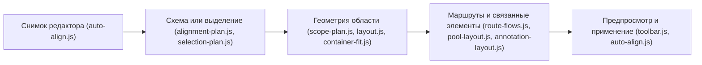

# BPMN Forge

[](https://github.com/DatKorso/bpmn-forge-web/actions/workflows/ci-cd.yml)
[](https://bpmn.korso.cc)

Браузерный редактор BPMN с автовыравниванием схем на русском языке.

**Открыть редактор: [bpmn.korso.cc](https://bpmn.korso.cc)** — установка не нужна, схемы обрабатываются в браузере.

## Возможности

- Создание и редактирование BPMN 2.0 на основе [bpmn-js](https://bpmn.io/toolkit/bpmn-js/).
- Открытие и скачивание файлов `.bpmn`.
- Автовыравнивание всей схемы или выделенного фрагмента с предпросмотром и отменой одним действием.
- Учёт пулов, дорожек, подпроцессов, граничных событий и объектов данных.
- Русский интерфейс.

## Локальный запуск

Для локальной разработки используйте Node.js 24.

```sh
npm ci
npm run dev     # редактор на локальном сервере Vite
npm test        # тесты Node.js
npm run build   # сборка сайта в dist/
```

## Браузерный тест

После `npm ci` установите Chromium и запустите тест собранного сайта.

```sh
npx playwright install chromium
npm run build
npm run test:e2e
```

Playwright сам запускает Vite Preview. В Linux для установки Chromium вместе с системными библиотеками используйте `npx playwright install --with-deps chromium`. При падении теста трасса сохраняется в `test-results/`, а в GitHub Actions её можно скачать из артефактов проверки.

## Как работает автовыравнивание

Кнопка «Выровнять схему» и сочетание `Alt+Enter` запускают выравнивание всей схемы. Для выделения используйте «Выровнять выделение» или `Alt+Shift+Enter`. Перед изменением схемы предпросмотр показывает количество перемещаемых фигур, контейнеров с новым размером и обновляемых связей. После применения выравнивание отменяется одним действием. Отступы сохраняются в браузере. В отчёте о пропусках кнопка «Показать на схеме» выделяет участок и прокручивает к нему полотно.



Планировщик работает с геометрией снимка. Конечные границы фигур и ломаные маршрутов применяются через командный стек bpmn-js. Сохраняются ссылки между элементами, членство в дорожках и прикрепление граничных событий. Минимальные отступы ограничивают расстановку. Максимальные по возможности сокращают расстояния, сохраняя качество маршрутов. Конфликт в области может привести к её пропуску с объяснением в отчёте.

Раскрытые подпроцессы, транзакции и событийные подпроцессы выравниваются вместе с содержимым. Свёрнутые подпроцессы и вызовы процессов участвуют как отдельные узлы. Ссылки на объекты и хранилища данных учитываются как препятствия. Группы остаются визуальными областями.

Чтобы добавить регрессию, сохраните BPMN с исходной геометрией в `test/fixtures/`. На Node.js 24 запустите команду ниже, проверьте границы, маршруты и причины пропусков в новом `*.golden.json` и добавьте оба файла в коммит. Изменения существующих ожидаемых результатов требуют отдельной проверки.

```sh
UPDATE_ALIGNMENT_GOLDENS=1 node --test test/alignment-golden.test.js
npm test
```

Для проверок импорта, истории и экспорта используйте `e2e/alignment.spec.js`. Для повторяемых замеров используйте `node scripts/benchmark-alignment.js`.

## Версия и история изменений

Базовая версия `0.1.0` хранится в `package.json` и `package-lock.json`. В футере средний разряд дополняется нулём до двух цифр. Например, `0.1.0` отображается как `0.01.0`, после `0.09.4` при повышении среднего разряда идёт `0.10.0`, а после `0.99.4` — `0.100.0`.

Базовой версией помечается коммит, который добавляет `scripts/build-metadata.js` на основную линию `main`. Далее каждый коммит на этой линии повышает версию один раз. Линия определяется по первым родителям собираемой ревизии. Для проверки pull request GitHub собирает тестовое слияние с `main`, поэтому в такой сборке отображается версия этого слияния.

- Маркер `!` после типа или области, например `refactor!:` или `fix(editor)!:`, либо строка `BREAKING CHANGE:` в теле коммита повышает первый разряд и обнуляет оба младших. Например, `0.10.3` становится `1.00.0`.
- Заголовок `feat:` или `feat(scope):` повышает средний разряд и обнуляет третий.
- Любой другой коммит повышает третий разряд.

Для merge-коммита учитывается наибольшее повышение среди самого слияния и коммитов, которые через него впервые попали в историю `main`. Для squash-коммита учитываются его заголовок и тело.

Сборка включает заголовки, даты и ссылки для последних 20 коммитов, доступных из собираемой ревизии, включая её саму. В окне «История изменений» есть ссылка на полную историю этой ревизии. Список доступен без обращения браузера к GitHub.

CI получает полную историю Git и останавливает сборку, если история или базовый коммит недоступны. В таком случае локальная сборка показывает `0.01.0` и сообщение «История изменений недоступна».

## Лицензия

Код BPMN Forge распространяется по лицензии [MIT](LICENSE).

Редактор построен на [bpmn-js](https://bpmn.io/toolkit/bpmn-js/) от Camunda Services GmbH, а раскладку графа рассчитывает [elkjs](https://github.com/kieler/elkjs), порт Eclipse Layout Kernel. Эти и другие сторонние библиотеки распространяются на условиях своих лицензий. Лицензия bpmn-js требует сохранять видимым водяной знак bpmn.io, elkjs распространяется по EPL-2.0. Подробности описаны в [THIRD_PARTY_NOTICES.md](THIRD_PARTY_NOTICES.md), полные тексты лицензий собраны в [bpmn.korso.cc/third-party-licenses.md](https://bpmn.korso.cc/third-party-licenses.md).
